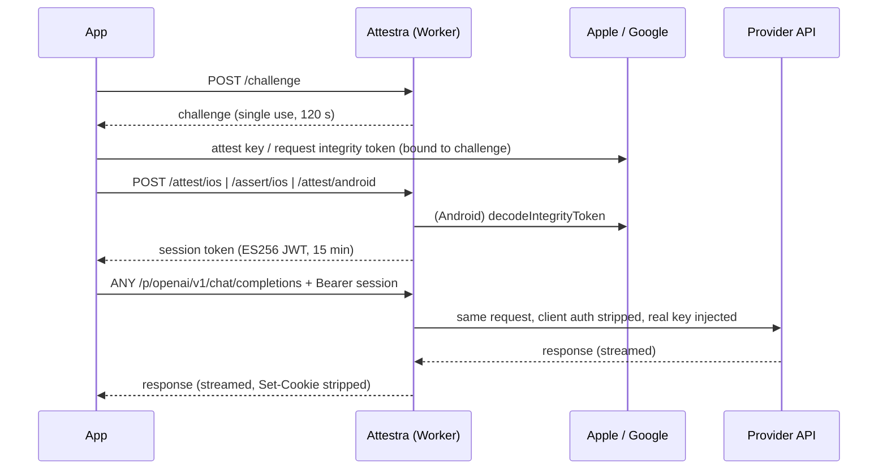

# Attestra

An attested API-key proxy for mobile apps, running as a Cloudflare Worker written in Rust.

Mobile apps should never ship third-party API keys. With Attestra they don't have to. The app
proves it is genuine (Apple **App Attest** on iOS, Google **Play Integrity** on Android) and
receives a short-lived session token. It then calls third-party APIs through the worker, which
injects the real key server-side. The proxy is generic: adding a provider is a config change,
not new code.



## Contents

- [How it works](#how-it-works)
- [API](#api)
- [Setup](#setup)
- [Adding a provider](#adding-a-provider)
- [Local development](#local-development)
- [Deployment](#deployment)
- [Operations](#operations)
- [Client SDKs](#client-sdks)
- [Security model](#security-model)
- [Project layout and tests](#project-layout-and-tests)

## How it works

**iOS (App Attest).**
- *First run:* the app generates a Secure Enclave key and attests it with Apple, over the hash
  of a server challenge. Attestra checks:
  - the certificate chain up to the embedded Apple App Attestation Root CA;
  - that the nonce equals `SHA256(authData ‖ SHA256(challenge))`;
  - that `key_id` equals SHA-256 of the public key;
  - the App ID hash, a zero counter, and the AAGUID (production, or development if allowed).

  It then stores the public key in D1.
- *Later launches:* the app signs a fresh challenge with the same key. Attestra verifies the
  signature and requires the counter to increase. The counter is stored atomically in a
  per-device Durable Object.

**Android (Play Integrity, Standard API).**
- The app requests an integrity token bound to
  `requestHash = base64url(SHA256(challenge ‖ install_id))`.
- Attestra decodes it with Google using a service account, then checks:
  - the package name and request hash;
  - token age (at most 2 minutes);
  - the `PLAY_RECOGNIZED` app verdict and the signing-certificate digest;
  - `MEETS_DEVICE_INTEGRITY`;
  - optionally, the `LICENSED` licensing verdict.

**Sessions and the proxy.**
- A successful attestation returns an ES256 session JWT.
- Proxied requests are checked against the provider's allowlist (method plus path glob) and
  size limit, then rate-limited per device and provider.
- Client credentials, cookies and forwarding headers are stripped, the key is injected, and the
  upstream response is streamed back unchanged. That includes SSE and chunked responses.
- Providers that set `require_assertion` also require a fresh App Attest assertion over each
  iOS request.

## API

All responses are JSON. Errors are `{"error": "<code>"}` and never say which check failed; the
detail only goes to server logs, at debug level. There is no CORS support: only mobile clients
call this API.

| Endpoint | Body | Success |
| --- | --- | --- |
| `POST /challenge` | none | `{"challenge": "<b64url 32 bytes>", "expires_at": <unix>}` |
| `POST /attest/ios` | `{"key_id": b64, "attestation": b64, "challenge": b64url}` | session |
| `POST /assert/ios` | `{"key_id": b64, "assertion": b64, "challenge": b64url}` | session |
| `POST /attest/android` | `{"integrity_token": str, "challenge": b64url, "install_id": uuid, "package_name"?: str}` | session |
| `ANY /p/{provider}/{*path}` | forwarded | upstream response |

A session is `{"token": "<jwt>", "expires_at": <unix>}`. Challenges are single use, and they are
consumed even when verification fails. `install_id` must be a lowercase UUID. `package_name` is
only needed when `ANDROID_PACKAGE_NAMES` lists several packages. Base64 fields accept standard
or URL-safe encoding, with or without padding.

Proxy requests send `Authorization: Bearer <token>`. For providers with
`require_assertion = true`, iOS clients also send:

```
X-Attestra-Assertion: <base64 App Attest assertion>
X-Attestra-Timestamp: <unix seconds>
```

The assertion's `clientData` is these four lines, joined with `\n`:

```
METHOD
PATH
b64url(SHA256(body))
unix_seconds
```

`PATH` is the percent-encoded request path, plus `?query` when there is a non-empty query
string, exactly as sent. For example: `/p/openai/v1/chat/completions?stream=true`. Timestamps
more than 60 s away from the server clock are rejected, and the assertion counter must increase.

| Code | Status | Meaning |
| --- | --- | --- |
| `bad_request` | 400 | Malformed JSON, base64, UUID, or a GET/HEAD request with a body |
| `challenge_invalid` | 400 | Challenge unknown, expired, already used, or malformed |
| `attestation_invalid` | 401 | Attestation, assertion or integrity verdict rejected |
| `session_invalid` | 401 | Missing, invalid or expired token, or unknown/revoked device |
| `forbidden` | 403 | Method or path not allowlisted, path traversal, or device revoked (at attest time) |
| `not_found` | 404 | Unknown route or provider |
| `method_not_allowed` | 405 | Wrong method on a JSON endpoint (response carries an `Allow` header) |
| `payload_too_large` | 413 | Body over the limit (64 KiB for attestation, `max_body_bytes` for the proxy) |
| `rate_limited` | 429 | Provider rate limit hit (response carries a `Retry-After` header) |
| `internal_error` | 500 | Misconfiguration (missing secret, invalid vars, ...) |
| `not_implemented` | 501 | The platform is not configured on this deployment |
| `upstream_error` | 502 | Google or the provider could not be reached |

## Setup

Prerequisites:
- Rust stable. `rust-toolchain.toml` installs the `wasm32-unknown-unknown` target.
- Node.js 20+.
- A Cloudflare account. Workers Paid is recommended: verifying an attestation takes several
  ECDSA operations (and an RSA signature on Android), which can exceed the Free plan's 10 ms
  CPU limit.

```sh
npm install                          # wrangler
cargo test                           # sanity check on the host
```

### 1. Create the D1 database

```sh
npx wrangler d1 create attestra      # copy the database_id into wrangler.toml
npx wrangler d1 migrations apply attestra --remote
```

### 2. Configure `[vars]` in `wrangler.toml`

Every value is a quoted string. If all of a platform's variables are left empty, that platform
is disabled (501). Setting only half of them is a startup error.

| Variable | Example | Notes |
| --- | --- | --- |
| `APPLE_TEAM_ID` | `"ABCDE12345"` | 10-character Team ID |
| `APPLE_BUNDLE_IDS` | `"com.example.app,com.example.app.beta"` | App ID = `TEAM_ID.bundle_id` |
| `APPLE_ALLOW_DEVELOPMENT` | `"false"` | Accept the `appattestdevelop` environment (debug builds) |
| `ANDROID_PACKAGE_NAMES` | `"com.example.app"` | Comma-separated |
| `ANDROID_CERT_SHA256` | `"AB:CD:…"` | Signing-certificate SHA-256 digests: hex (with or without colons) or base64 |
| `ANDROID_REQUIRE_LICENSED` | `"true"` | Require `appLicensingVerdict == LICENSED` (default `true`) |
| `SESSION_TTL_SECONDS` | `"900"` | 60–86400 |
| `CHALLENGE_TTL_SECONDS` | `"120"` | 10–600 |

For `ANDROID_CERT_SHA256`, use the **app signing key** digest from Play Console → *Test and
release* → *App integrity*, not your upload key. With Play App Signing, Google signs the
installed APKs.

### 3. Set secrets

```sh
# ES256 session signing key (P-256, PKCS#8 PEM)
openssl ecparam -name prime256v1 -genkey -noout | openssl pkcs8 -topk8 -nocrypt > session.pem
npx wrangler secret put SESSION_SIGNING_KEY < session.pem && rm session.pem

# Google service account key (JSON), for Android
npx wrangler secret put GOOGLE_SERVICE_ACCOUNT_JSON < service-account.json

# One secret per provider, named by `secret` in config/providers.toml
npx wrangler secret put OPENAI_API_KEY
npx wrangler secret put GMAPS_KEY
```

The names `SESSION_SIGNING_KEY` and `GOOGLE_SERVICE_ACCOUNT_JSON` are reserved: a provider
config that names either one is rejected. That way an internal secret can never be forwarded to
a third party.

### 4. Platform setup

**iOS**
- Add the *App Attest* capability. It is the entitlement
  `com.apple.developer.devicecheck.appattest-environment`: `development` for debug builds,
  `production` for TestFlight and the App Store.
- Debug builds attest in the development environment, which the worker only accepts with
  `APPLE_ALLOW_DEVELOPMENT = "true"`. Keep it `false` in production.

**Android**
- In Play Console → *App integrity* → *Play Integrity API*, link a Google Cloud project. Enable
  the *Play Integrity API* in that project.
- Create a service account in the same project and download a JSON key. It needs no IAM role;
  the project link is what authorizes it.
- The app needs the Cloud **project number** (not the ID) for
  `PrepareIntegrityTokenRequest`.

## Adding a provider

Providers live in [`config/providers.toml`](config/providers.toml). The file is compiled into
the worker and validated when it loads. `cargo test` fails if it is invalid.

```toml
[providers.openai]
base_url = "https://api.openai.com"            # https origin, optional path prefix
secret = "OPENAI_API_KEY"                      # Worker secret holding the key
auth = { kind = "header", name = "Authorization", format = "Bearer {key}" }
allow = [ { method = "POST", path = "/v1/chat/completions" } ]
rate_limit = { per_minute = 60, per_day = 2000 }   # per device, optional
max_body_bytes = 1048576                       # default 1 MiB
require_assertion = false                      # iOS: per-request App Attest assertion
```

- **`auth`**
  - `{ kind = "header", name, format }`. `format` defaults to `"{key}"`.
  - `{ kind = "query", name }`. Any client-supplied parameter with that name is dropped,
    whatever its case or percent-encoding.
  - `{ kind = "basic", format }`. Produces `Authorization: Basic base64(format)`, e.g.
    `format = "{key}:"` for Stripe or `"api:{key}"` for Mailgun.
- **`allow`** lists method/path pairs. `*` matches one or more whole path segments, e.g.
  `/maps/api/place/*` or `/v1beta/models/*/generateContent`. Anything else is `forbidden`.
  Paths are normalized first: `.`/`..` segments, empty segments, backslashes and encoded
  `/ \ . %` or control characters are rejected outright.
- **`rate_limit`** uses fixed UTC minute and day windows per (device, provider).

Then add the secret (`wrangler secret put …`) and redeploy.

Clients call `/p/openai/v1/chat/completions` exactly as they would call
`https://api.openai.com/v1/chat/completions`.

## Local development

```sh
cp .dev.vars.example .dev.vars              # SESSION_SIGNING_KEY, provider keys, ...
npx wrangler d1 migrations apply attestra --local
npx wrangler dev \
  --var APPLE_TEAM_ID:ABCDE12345 --var APPLE_BUNDLE_IDS:com.example.app
```

`wrangler dev` runs the real build (`worker-build`) and serves Durable Objects and D1 locally.
It rebuilds when `worker/src`, `crates` or `config` change.

- **Attestation needs real devices.** A simulator cannot use App Attest, and Play Integrity
  needs a Play-installed build. Point a device build at the dev server, for example with
  `wrangler dev --ip 0.0.0.0`.
- **Testing the proxy without devices.** Insert a device row into the local D1 and sign a
  session JWT with your dev `SESSION_SIGNING_KEY`, using the `session` crate's
  `SessionKey::issue`.
- **Known dev-only quirk.** After the worker rejects an oversized *chunked* upload, wrangler's
  local proxy fails the next request once ("Network connection lost"). Deployed workers are not
  affected.

## Deployment

```sh
npx wrangler d1 migrations apply attestra --remote
npx wrangler deploy
```

Recommended on the zone:
- A WAF rate-limiting rule on `POST /challenge` and the `/attest/*` and `/assert/*` routes,
  per IP. These endpoints are unauthenticated.
- A custom domain.

Observability (logs) is enabled in `wrangler.toml`. Logs never contain request or response
bodies, API keys, tokens or attestation blobs.

## Operations

**Revoke a device.** New sessions are refused immediately. Existing sessions stop working
within 60 s (the per-isolate device cache).

```sh
npx wrangler d1 execute attestra --remote \
  --command "UPDATE devices SET revoked = 1 WHERE id = '<device id>'"
```

Device IDs work like this:
- **iOS:** `hex(key_id)`. Revocation applies to one App Attest key, i.e. one install.
- **Android:** `hex(SHA256(package_name ‖ install_id))`, i.e. one install.

Attestation cannot recognize the same physical device across reinstalls.

**Rotate the session key.** Run `wrangler secret put SESSION_SIGNING_KEY`. Every existing
session becomes invalid; the SDKs silently re-assert on the next 401.

**Rotate a provider key.** Run `wrangler secret put <SECRET>`. It deploys a new version, so
the new key is used immediately.

## Client SDKs

### iOS: `clients/swift/AttestraClient`

Swift Package, iOS 15+, async/await, Swift 6 concurrency-safe.

```swift
import AttestraClient

let attestra = AttestraClient(configuration: .init(baseURL: URL(string: "https://attestra.example.com")!))

guard attestra.isSupported else { /* DCAppAttestService unsupported: degrade gracefully */ return }

let body = try JSONEncoder().encode(chatRequest)
let (data, response) = try await attestra.send(ProxyRequest(
    provider: "openai",
    path: "/v1/chat/completions",
    method: "POST",
    headers: ["Content-Type": "application/json"],
    body: body,
    requireAssertion: false   // true for providers with require_assertion
))
```

What the SDK handles:
- It stores the App Attest key ID in the Keychain (this device only).
- First run: attest. Later runs: assert. Sessions are cached and refreshed 60 s before expiry,
  and concurrent callers share one refresh.
- If the key is invalidated (`DCError.invalidKey`) or the server no longer knows it, a new key
  is attested.
- A request is retried once when Attestra returns 401. A 401 relayed from the provider is not
  retried.
- When `isSupported` is false (for example on the simulator), calls throw
  `AttestraError.appAttestUnsupported`.

For streaming (SSE), call `currentSession()` and send the request with your own `URLSession`.

### Android: `clients/android/attestra-client`

Kotlin library, minSdk 23, coroutines, Play Integrity Standard API.

```kotlin
val attestra = AttestraClient(
    AttestraConfig(baseUrl = "https://attestra.example.com"),
    PlayIntegrityTokenSource(context, cloudProjectNumber = 123456789012L),
    SharedPreferencesInstallIdStore(context),
)
attestra.warmUp()   // at app start: prepares the integrity token provider

val response = attestra.send(ProxyRequest("openai", "/v1/chat/completions", "POST",
    headers = mapOf("Content-Type" to "application/json"), body = json.toByteArray()))
```

The session logic matches iOS: a cached session with a refresh margin, one retry on
Attestra's 401, and single-flight attestation. An expired token provider is prepared again
automatically. The default transport is `HttpURLConnection` (buffered); pass your own
`HttpTransport` to use OkHttp.

## Security model

What a session proves: at attestation time, the caller was a genuine, unmodified build of your
app on a device Apple or Google vouches for.

What that stops:
- Keys scraped from the binary.
- Scripts replaying requests with a stolen key.
- Repackaged or sideloaded apps.
- On Android, rooted devices failing `MEETS_DEVICE_INTEGRITY`.

What it does not stop: a genuine app on a genuine device being driven by its user. That is what
the per-device rate limits, allowlists and body caps are for. For high-value iOS endpoints,
`require_assertion` binds every request to the Secure Enclave key: method, path, query, body
and a fresh timestamp.

Implementation notes:
- **Crypto.**
  - Pure-Rust RustCrypto only (`p256`, `p384`, `sha2`, `rsa`, `x509-cert`, `der`, `spki`).
  - Hashes, nonces, request hashes and certificate digests are compared in constant time
    (`subtle`).
  - `rsa` is pinned to `=0.10.0-rc.18` because 0.9 carries the Marvin timing advisory
    (RUSTSEC-2023-0071).
- **Real-device test vectors.** App Attest parsing is tested against 12 real attestations and
  10 real assertions from open-source projects; see
  [`crates/attest-apple/tests/fixtures`](crates/attest-apple/tests/fixtures/README.md). They
  pin two easy-to-miss details:
  - the assertion signature is ECDSA-SHA256 over `nonce`, so the ECDSA digest is
    `SHA256(SHA256(authData ‖ clientDataHash))`;
  - assertions set flag `0x40` without carrying credential data.
- **Replay.** Challenges are single use (one Durable Object per challenge, deleted
  atomically). Assertion counters are compare-and-set in the device's Durable Object.
- **Proxy hygiene.**
  - Redirects are not followed.
  - `Set-Cookie`, hop-by-hop and `Access-Control-*` headers are stripped from responses, as is
    any header that echoes the key.
  - Provider keys must be printable ASCII, so they cannot inject header lines.
- **Limits.** A provider could still echo the key in a response *body*; Attestra streams bodies
  unchanged and cannot scrub them. Fixed rate-limit windows allow up to 2× the limit across a
  window boundary.

## Project layout and tests

```
crates/attest-apple   App Attest attestation + assertion verification (no worker deps)
crates/attest-google  Play Integrity: service-account JWT, decode, verdict (HttpClient trait)
crates/session        ES256 session JWTs
crates/proxy-core     providers.toml, allowlist matching, rewriting, rate windows, assertion format
worker/               worker-rs entry, routing, D1, Durable Objects (ChallengeStore, DeviceState)
config/providers.toml provider registry (compiled in)
migrations/           D1 schema
clients/swift         iOS Swift Package
clients/android       Android Kotlin library
```

The core crates never depend on `worker` and test on the host. The worker's pure modules
(config, errors, routing, encoding) are unit-tested as well.

```sh
cargo test                                               # all Rust tests, incl. real-device fixtures
cargo clippy --all-targets -- -D warnings
cargo clippy --target wasm32-unknown-unknown -- -D warnings
(cd clients/swift/AttestraClient && swift test)
(cd clients/android && ./gradlew :attestra-client:testDebugUnitTest)
```

The URL-encoding vector `/p/gemini/v1beta/models/gemini%20pro:generateContent?q=…` is asserted
identically in Rust, Swift and Kotlin, so per-request assertions cannot drift between the
clients and the worker.

**Build notes.**
- The release profile uses `strip = "debuginfo"` rather than `strip = true`. Stripping symbols
  also drops the wasm `target_features` section, and worker-build's panic-recovery step then
  fails in wasm-bindgen ("externref table required for catch wrappers").
- The optimized module is ≈1.5 MB (≈490 KiB gzipped).
